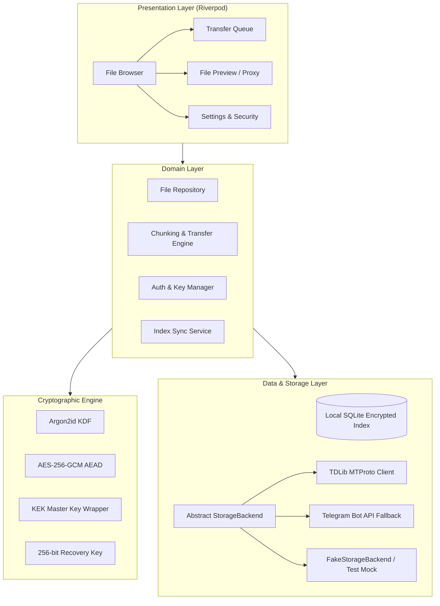

# Filo — Zero-Knowledge Personal Cloud Storage

[](https://github.com/filo/filo/actions/workflows/ci.yml)
[](LICENSE)
[](https://flutter.dev)
[](https://dart.dev)

**Filo** is a production-grade, zero-knowledge mobile cloud storage and file management app for iOS and Android that uses your **own Telegram account** as the storage backend.

Users upload, organize, preview, search, download, and share files. All files live inside the user's private Telegram channel container (`filo`). We run **zero servers**, store **zero user data**, collect **zero telemetry**, and hold **zero cryptographic keys**.

---

## 🔒 Core Principles (Non-Negotiable)

1. **User Owns 100% of the Data:** No developer backends, proxies, or analytics touching file contents or metadata. All MTProto traffic flows directly from your device to Telegram's distributed data centers.
2. **Zero-Knowledge by Default:** Every file is encrypted on-device before transmission using **AES-256-GCM** authenticated chunked streaming encryption.
3. **Hardware-Anchored Key Hierarchy:** Master encryption keys are derived from your master passphrase using **Argon2id** (64 MB memory, 3 iterations, 4 lanes). Master keys are wrapped using a Key Encrypting Key (KEK) and stored securely in iOS Keychain / Android Keystore. Changing your passphrase re-wraps the master key in milliseconds without re-encrypting existing files in Telegram.
4. **Resumable Large-File Chunking:** Large files exceeding single upload thresholds are automatically chunked with individual cryptographic initialization vectors and HMAC tags, linked via an authenticated file manifest.
5. **Decrypted Loopback Streaming:** Media playback (audio and video) is streamed on-demand via a 127.0.0.1 local decrypting HTTP proxy, supporting native Range requests and instant seeking without writing unencrypted multi-gigabyte files to disk.
6. **Native Craft Design:** Follows Apple Design and Emil Kowalski design engineering principles — spring-based physics, 44pt minimum touch targets, haptics on meaningful interactions, and strict compliance with `prefers-reduced-motion`.
7. **Cloud Snapshot & Re-Install Recovery:** The file catalog and wrapped key bundles are encrypted into a zero-knowledge snapshot envelope (`index.filo`) pinned directly to Telegram channel `filo`. When reinstalling or setting up a new device, Filo automatically discovers your vault and restores all files upon entering your passphrase or recovery key.
8. **Native Background Resilience:** Native Android Foreground Data Sync Service (`FiloTransferService`) with keep-alive integration prevents OS battery managers from pausing or killing uploads and downloads when minimized.
9. **Zero-Dependency 120fps QR Vault Pairing:** Effortlessly pair or migrate vaults between devices using a lightweight pure Dart visual QR code generator and pairing tokens.

---

## 🏗 System Architecture



---

## 🚀 Getting Started

### 1. Prerequisites
- **Flutter SDK**: 3.50.1 or newer (Channel `stable`)
- **Dart SDK**: 3.14.0 or newer
- **Android Studio / Xcode**: Configured for Flutter mobile builds
- **Telegram API Credentials**:
  1. Visit [my.telegram.org](https://my.telegram.org) and log in with your phone number.
  2. Navigate to **API development tools**.
  3. Create an application (e.g. `Filo Vault`) to receive your unique `api_id` and `api_hash`.

### 2. Environment Configuration
Filo does not commit API credentials to version control. Pass them securely at build time using `--dart-define` or a `.env` file:

```bash
# Export your Telegram developer credentials
export TELEGRAM_API_ID=12345678
export TELEGRAM_API_HASH="0123456789abcdef0123456789abcdef"
```

---

## 🛠 Build & Run Commands

### Run Locally (Development)
```bash
flutter run \
  --dart-define=TELEGRAM_API_ID=$TELEGRAM_API_ID \
  --dart-define=TELEGRAM_API_HASH=$TELEGRAM_API_HASH
```

### Build Android Debug APK
```bash
flutter build apk --debug \
  --dart-define=TELEGRAM_API_ID=$TELEGRAM_API_ID \
  --dart-define=TELEGRAM_API_HASH=$TELEGRAM_API_HASH
```
The output APK will be located at `build/app/outputs/flutter-apk/app-debug.apk`.

### Build Android Release App Bundle (AAB)
```bash
flutter build appbundle --release \
  --dart-define=TELEGRAM_API_ID=$TELEGRAM_API_ID \
  --dart-define=TELEGRAM_API_HASH=$TELEGRAM_API_HASH
```
The output bundle will be located at `build/app/outputs/bundle/release/app-release.aab`.

### Build iOS (Release, No Code-Signing for CI/Staging)
```bash
flutter build ios --release --no-codesign \
  --dart-define=TELEGRAM_API_ID=$TELEGRAM_API_ID \
  --dart-define=TELEGRAM_API_HASH=$TELEGRAM_API_HASH
```

---

## 🧪 Testing & Static Analysis

Filo maintains a strict zero-warning policy and extensive automated test suite covering crypto vectors, SQLite operations, and UI widgets:

```bash
# Run strict linter and static analysis
flutter analyze

# Run all unit, widget, and integration tests
flutter test

# Run tests with code coverage output
flutter test --coverage
```

### Test Coverage Highlights
- **Crypto Engine (`test/unit/crypto_test.dart`)**:
  - Authenticated AES-256-GCM encryption and decryption round-trips.
  - Argon2id deterministic key derivation with constant memory/iteration costs.
  - KEK key wrapping and fast Master Key re-wrapping on passphrase change.
  - Emergency 256-bit recovery key formatting and offline parsing.
  - Constant-time hash verification.
- **Database & Virtual Tree (`test/unit/database_test.dart`)**:
  - Virtual folder hierarchy, nested path resolution, breadcrumb computation.
  - Soft deletion, Trash recovery, permanent purge, and storage analytics aggregation.
  - Multi-part chunk ordering and manifest integrity.
- **Sync & Resumable Transfer (`test/unit/sync_and_transfer_test.dart`)**:
  - Zero-knowledge cloud index snapshot backup to pinned Telegram messages.
  - Fresh device cloud restore and snapshot integrity verification.
  - Chunking engine streaming splitting, encryption, and byte-for-byte reassembly.
- **Widget & Design System (`test/widget/`)**:
  - Emil Kowalski button feedback (instant 0.97 scale press feedback, haptics).
  - Welcome screen and Telegram onboarding flows.
  - Passphrase strength meter and loss disclaimer gates.

---

## 🔐 Security Specifications

| Layer | Standard | Details |
|---|---|---|
| **Data Encryption** | AES-256-GCM | 256-bit key, 96-bit random IV per chunk, 128-bit authentication tag |
| **Passphrase KDF** | Argon2id | Memory: 64 MB (`65536 KB`), Iterations: `3`, Parallelism: `4` |
| **Key Wrapping** | AES-256-GCM KEK | Master Key re-wrapped on passphrase change without touching files |
| **Integrity** | SHA-256 + GCM Tag | Pre-upload hash vs post-download hash comparison |
| **Local Database** | Encrypted SQLite | Virtual directory tree, MIME types, and chunk metadata |
| **Screen Privacy** | OS-Level Shield | Android `FLAG_SECURE`, iOS blur veil on backgrounding |
| **App Lock** | Biometric / PIN | LocalAuth with auto-lock timeout options (0, 1, 5, 15, 30 min) |

For our complete threat model and security audit, see [`docs/SECURITY.md`](docs/SECURITY.md).

---

## 📁 Repository Structure

```
filo/
├── android/                    # Native Android project & signing configurations
├── assets/
│   └── icon/                  # Master app icons (PNG 1024x1024, SVG)
├── docs/
│   ├── DECISIONS.md           # Architecture Decision Records (ADRs)
│   ├── PLAN.md                # Comprehensive system execution plan
│   ├── QA.md                  # Manual QA test matrix (offline, transfers, 2FA)
│   ├── SECURITY.md            # Threat model, parameters & zero-logging rules
│   ├── STORE.md               # Google Play & Apple Privacy Nutrition declarations
│   └── legal/
│       ├── PRIVACY_POLICY.md  # Zero-knowledge privacy policy
│       └── TERMS_OF_SERVICE.md# Terms of service and Telegram disclaimer
├── ios/                       # Native iOS project & xcassets
├── lib/
│   ├── core/
│   │   ├── config/            # AppConfig (single source for appName and constants)
│   │   ├── crypto/            # AES-256-GCM, Argon2id, KeyWrapper, RecoveryKey
│   │   ├── database/          # SQLite virtual filesystem, chunk & transfer models
│   │   ├── proxy/             # 127.0.0.1 decrypted HTTP streaming server
│   │   └── theme/             # Design tokens (colors, typography, motion, radius)
│   ├── features/
│   │   ├── auth/              # Phone/code/2FA onboarding, biometrics, app lock
│   │   ├── files/             # Virtual browser, breadcrumbs, search, trash, actions
│   │   ├── preview/           # Zoomable images, syntax code viewer, metadata fallback
│   │   ├── settings/          # Storage breakdown, re-wrap key, GDPR export/wipe
│   │   ├── storage/           # Abstract backend, TDLib, Bot API, and Mock
│   │   ├── sync/              # Pinned cloud index backup and restore
│   │   └── transfer/          # Resumable chunking engine, transfer queue
│   ├── shared/
│   │   └── components/        # FiloButton, FiloCard, FiloSheet, FiloToast
│   └── main.dart              # App initialization and lifecycle privacy shield
├── scripts/
│   └── generate_app_icons.py  # Automated icon generator script
├── test/                      # Unit and widget test suite
└── pubspec.yaml               # Dependencies and build configuration
```

---

## ⚖️ Legal & Telegram Compliance

- **Independent Project:** Filo is an independent open-source software project. It is not affiliated with, authorized, maintained, sponsored, or endorsed by Telegram FZ-LLC or any of its affiliates.
- **Telegram API Terms:** Filo respects Telegram's Terms of Service and API Guidelines. Filo does not use official Telegram logos as its own brand identity and operates strictly on the user's explicit authorization.
- **Storage Provider Notice:** Users utilize their personal Telegram storage limits in accordance with Telegram's terms. Telegram reserves the right to modify API rate limits and service terms.

---

## 📄 License

This project is licensed under the MIT License — see the [LICENSE](LICENSE) file for details.
