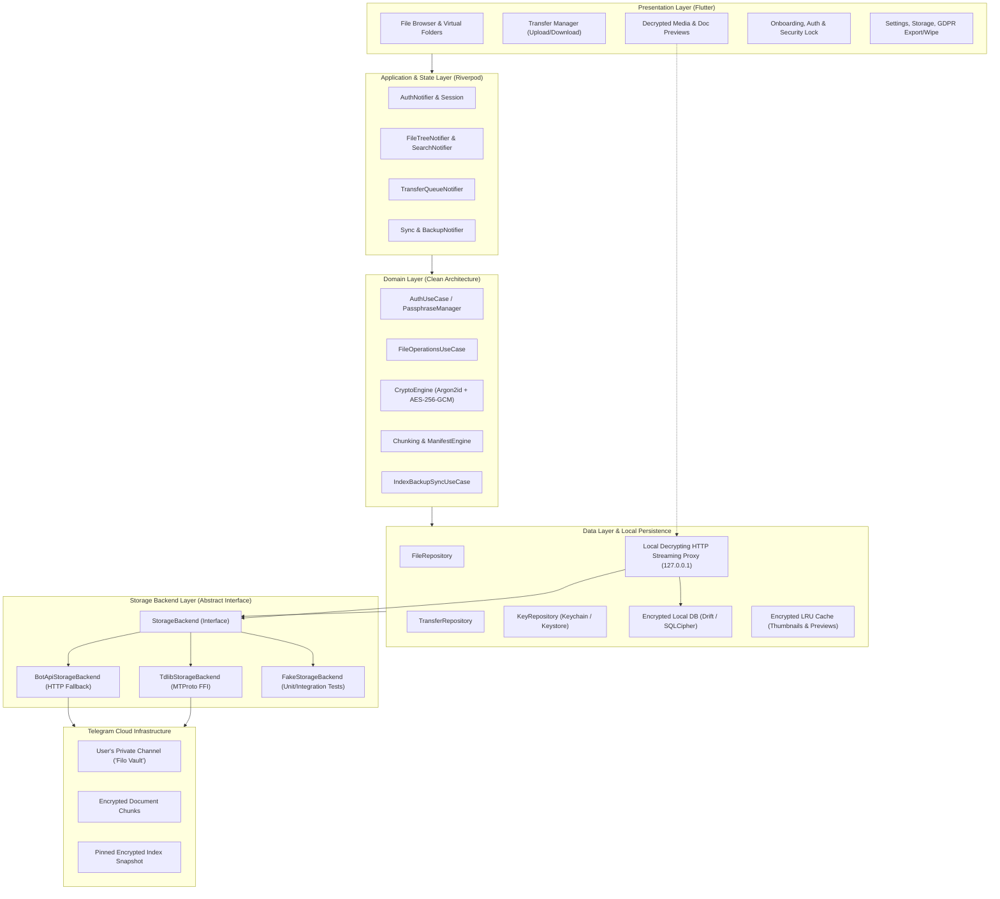
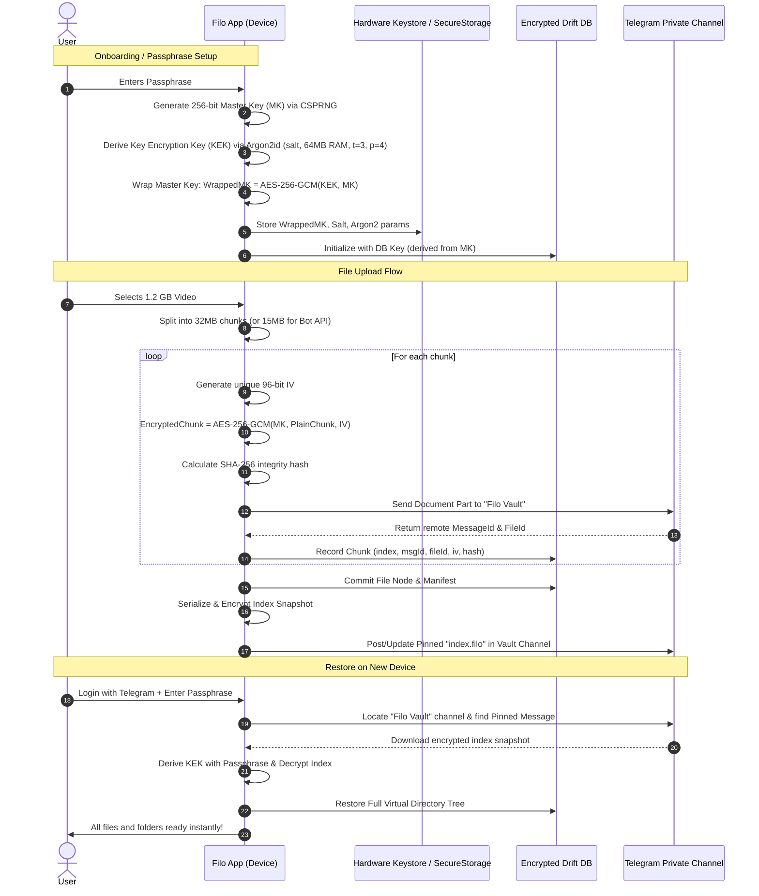

# Filo - System Architecture & Execution Plan

## 1. System Architecture Overview



---

## 2. Cryptographic Data Flow



---

## 3. Data Model Specification

### 3.1 SQLite Tables (Drift + SQLCipher)

#### `nodes` (Files and Folders)
- `id` (TEXT PRIMARY KEY) - UUID v4
- `parent_id` (TEXT NULL) - References `nodes(id)`, NULL for root directory
- `name` (TEXT NOT NULL) - Display name (e.g. `document.pdf`)
- `type` (TEXT NOT NULL) - Enum: `'file'`, `'folder'`
- `size_bytes` (INTEGER NOT NULL) - Total plaintext file size
- `mime_type` (TEXT NULL) - Detected MIME type (e.g. `video/mp4`, `image/jpeg`)
- `content_hash` (TEXT NULL) - SHA-256 hash of plaintext for duplicate detection
- `created_at` (INTEGER NOT NULL) - Epoch milliseconds
- `modified_at` (INTEGER NOT NULL) - Epoch milliseconds
- `is_favorite` (INTEGER NOT NULL DEFAULT 0) - Boolean (0/1)
- `is_trashed` (INTEGER NOT NULL DEFAULT 0) - Boolean (0/1)
- `trashed_at` (INTEGER NULL) - Epoch milliseconds when moved to trash
- `encryption_iv` (TEXT NULL) - Hex or base64 initialization vector
- `manifest_json` (TEXT NULL) - JSON array of chunk IDs/hashes
- `sync_state` (TEXT NOT NULL DEFAULT 'synced') - Enum: `'local_only'`, `'uploading'`, `'synced'`, `'modified'`, `'deleting'`

#### `chunks` (Parts of Large Files)
- `id` (TEXT PRIMARY KEY) - UUID v4
- `node_id` (TEXT NOT NULL) - Foreign Key -> `nodes(id)` ON DELETE CASCADE
- `chunk_index` (INTEGER NOT NULL) - 0-based part index
- `remote_message_id` (TEXT NOT NULL) - Telegram message ID containing the document
- `remote_file_id` (TEXT NOT NULL) - Telegram file ID / document ID
- `size_bytes` (INTEGER NOT NULL) - Ciphertext size of this chunk
- `sha256_hash` (TEXT NOT NULL) - Integrity verification hash of ciphertext
- `iv` (TEXT NOT NULL) - 12-byte initialization vector for this specific chunk

#### `transfer_tasks` (Upload/Download Queue)
- `id` (TEXT PRIMARY KEY) - UUID v4
- `node_id` (TEXT NOT NULL) - Reference to file node
- `type` (TEXT NOT NULL) - `'upload'`, `'download'`
- `status` (TEXT NOT NULL) - `'queued'`, `'running'`, `'paused'`, `'completed'`, `'failed'`
- `progress` (REAL NOT NULL DEFAULT 0.0) - Progress float between 0.0 and 1.0
- `bytes_transferred` (INTEGER NOT NULL DEFAULT 0)
- `total_bytes` (INTEGER NOT NULL)
- `error_message` (TEXT NULL)
- `created_at` (INTEGER NOT NULL)
- `updated_at` (INTEGER NOT NULL)

#### `app_metadata` (Key-Value Metadata)
- `key` (TEXT PRIMARY KEY)
- `value` (TEXT NOT NULL)

---

## 4. Module & Directory Breakdown

```
filo/
├── lib/
│   ├── core/
│   │   ├── config/              # AppConfig (appName = "Filo", constants, Telegram API keys)
│   │   ├── crypto/              # Argon2id, AES-256-GCM streaming, key wrapping, CSPRNG
│   │   ├── database/            # Drift database, schema, queries, migrations, SQLCipher integration
│   │   ├── errors/              # AppExceptions, Failure hierarchy, user-facing error messages
│   │   ├── network/             # Network listener, retry policies, flood-wait backoff
│   │   ├── proxy/               # Local decrypting HTTP streaming proxy for media (127.0.0.1)
│   │   ├── security/            # Biometric lock, secure storage, auto-lock timer, flag secure
│   │   ├── theme/               # FiloColors, FiloTypography, FiloSpacing, FiloMotion, design tokens
│   │   └── utils/               # Hash utils, formatters, MIME resolver, path helpers
│   ├── features/
│   │   ├── auth/                # Presentation, Domain, Data for Telegram login & passphrase setup
│   │   ├── files/               # Presentation (grid/list/folders/search), Domain (CRUD), Data
│   │   ├── transfer/            # Presentation (queue sheet), Domain (chunker/resumer), Data
│   │   ├── preview/             # Audio, video, image, PDF, text, code, fallback viewers
│   │   ├── sync/                # Pinned index snapshot serialization, restore, conflict resolution
│   │   └── settings/            # Security, storage stats, GDPR export, data wipe, theme, about
│   ├── shared/
│   │   ├── components/          # FiloButton, FiloCard, FiloSheet, FiloToast, FiloProgress, FiloEmptyState
│   │   └── layout/              # Responsive scaffolds, adaptive safe-area, navigation bars
│   └── main.dart                # App entrypoint, Riverpod ProviderScope, theme listener
├── test/
│   ├── unit/                    # Crypto vectors, Argon2id, chunking, manifest, SQLCipher queries
│   ├── widget/                  # Core design components, file browser, auth screen, empty states
│   └── integration/             # Full upload/download/restore flow using FakeStorageBackend
├── docs/
│   ├── PLAN.md                  # This file
│   ├── DECISIONS.md             # Architectural decision records
│   ├── SECURITY.md              # Threat model & cryptographic audit
│   ├── QA.md                    # Manual testing matrix
│   ├── STORE.md                 # Store listing, data safety, privacy nutrition label
│   └── legal/
│       ├── PRIVACY_POLICY.md    # Transparent zero-knowledge privacy policy
│       └── TERMS_OF_SERVICE.md  # Terms of service & Telegram disclaimers
```

---

## 5. Risk Assessment & Mitigations

| Risk | Impact | Probability | Mitigation |
|---|---|---|---|
| **Telegram Flood-Wait / Rate Limits** | Uploads/downloads temporarily throttled | Medium | Exponential backoff with jitter (`429 Too Many Requests` parser). Clear user-facing status indicator in transfer queue. |
| **Telegram File Size Limit** | Upload failure for files > 2GB (MTProto) or > 20MB (Bot API) | High | Multi-part chunking engine with manifest. Files are transparently sliced into standard parts (32MB for MTProto, 15MB for Bot API). |
| **Lost Passphrase** | Permanent data loss (zero-knowledge) | Medium | Prominent user confirmation during onboarding: explicit check that if passphrase is lost, data cannot be recovered. Exportable recovery key (mnemonic/hex). |
| **Out-of-Memory during GB File Transfers** | App crash during encryption/transfer | High | Chunked streaming pipelines (`Stream<List<int>>`) piped directly through AES-GCM cipher sinks. Never load entire files into memory. |
| **Video Player Seeking in Encrypted Files** | Choppy playback or memory exhaustion | High | Local loopback HTTP streaming server (`127.0.0.1:<port>`) supporting HTTP Range requests (`bytes=start-end`), decrypting only the targeted chunks on demand. |
| **App Termination Mid-Transfer** | Incomplete chunks in cloud | Medium | SQLite-backed transfer queue tracking state per chunk. On app restart, resumes exactly from the last uncommitted chunk. |
| **Telegram API Policy Changes** | Telegram changes terms or limits | Low | Disclaimed in Terms of Service; swappable `StorageBackend` allows alternative storage integrations. |

---

## 6. Execution & Verification Matrix

- [x] **Phase 0: Plan & Architecture** - Detailed specifications, decisions, design tokens, repo structure, CI configuration.
- [ ] **Phase 1: Foundations** - Crypto module (Argon2id, AES-256-GCM, wrapping), Drift SQLCipher DB, `StorageBackend` abstraction, Fake & Real Telegram implementations.
- [ ] **Phase 2: Core Flows** - Onboarding, Passphrase setup, File/Folder browser, Transfer queue, Decrypted previews.
- [ ] **Phase 3: Reliability** - Index backup/restore, resumable chunk transfers, flood-wait handling, local streaming media proxy.
- [ ] **Phase 4: Polish** - Emil Kowalski / Apple design principles, spring physics, haptics, dark mode, accessibility, toast notifications.
- [ ] **Phase 5: Hardening** - Security threat model validation, test coverage (80%+ target), dependency audit, linting.
- [ ] **Phase 6: Release Prep** - Store metadata, icons/assets, legal docs, README, final QA checklist, Final Report.
